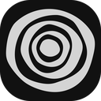

<div align="center">
  
  <h1>Umber Browser</h1>
  <p><strong>A fast, modern, and privacy-focused web browser built for Windows.</strong></p>

  <p>
    <a href="CHANGELOG.md">
      
    </a>
    <a href="https://dotnet.microsoft.com/download/dotnet/9.0">
      
    </a>
    <a href="LICENSE">
      
    </a>
  </p>
</div>

---

## Overview

**Umber** is a lightweight, hardware-accelerated Windows desktop web browser. Built on WPF and the Microsoft Edge WebView2 (Chromium) engine, it delivers a lightning-fast native experience while maintaining rendering parity with modern web standards.

We set out to build a browser that rethinks desktop tab management, respects your privacy, and eliminates the bloated aesthetics of modern browsers.

## Key Features

- **Favicon Pill Tabs**: A tab strip that compresses inactive tabs into clean icons and expands the active one, saving vertical and horizontal screen space.
- **Command Bar Navigation**: Say goodbye to the permanent, bulky URL bar. Press `Ctrl+L` to invoke a floating, intelligent command bar with instant local history and autocomplete.
- **Native Ad & Tracker Blocking**: Built-in network-level blocking capabilities with native support for parsing and applying **uBlock Origin** rules, enhanced with custom cosmetic filters.
- **Smart Memory Management**: Tab hibernation and least recently used eviction reduce live WebView controls within each window. The configured control budget is a soft limit. Pinned tabs, audio, internal pages, previews and tabs that own live downloads can stay loaded. It does not cap total process or renderer memory.
- **Force Dark Mode**: Integrated Dark Reader functionality to seamlessly force dark mode on websites that lack native dark themes.
- **Adaptive Tab Bar**: The browser UI intelligently adapts its color palette based on the active website's theme.
- **Focus Mode**: Distraction-free browsing modes with built-in domain blocklists to keep you on track.
- **YouTube Enhancer**: Native integration to enforce default video quality, playback speed, looping, and distraction removal ("Unhook").
- **Native Download Manager**: Built-in download tracker with real-time speed calculation and ETAs.
- **Custom Start Pages**: Personalize your New Tab page with beautiful, custom background image options.
- **OneTab Consolidation**: Built-in tools for sweeping your open tabs into a single, clean list for later reading.

## Installation

Umber is restarting at version 0.1.0. No installer is currently published.
Build from source using the instructions below. Future installers and update packages will be available on the [releases page](https://github.com/danieldamilola/Umber/releases).

## Development & Building from Source

If you want to build Umber yourself, you'll need the following prerequisites:
- **OS**: Windows 10 (1809+) or Windows 11 (x64)
- **SDK**: [.NET 9.0 SDK](https://dotnet.microsoft.com/download/dotnet/9.0)
- **Runtime**: [Evergreen WebView2 Runtime](https://developer.microsoft.com/microsoft-edge/webview2/) (Usually pre-installed on Windows 11)

### Build Instructions

1. **Clone the repository:**
   ```bash
   git clone https://github.com/danieldamilola/Umber.git
   cd Umber
   ```
2. **Build the project:**
   ```bash
   dotnet build Umber.csproj -c Release
   ```
3. **Run the browser:**
   ```bash
   dotnet run --project Umber.csproj -c Release
   ```
4. **Run Unit Tests:**
   ```bash
   dotnet test UmberBrowser.Tests/UmberBrowser.Tests.csproj
   ```

### Building the Installer
Umber uses a custom micro-updater. The build script generates both `Umber-win-Setup.exe` for installation and `Umber-win-x64.zip` for updates:
```powershell
.\build-release.ps1
```

## Roadmap & Future Plans

Umber is constantly evolving. Here is a glimpse into our development roadmap:

- [ ] **Cross-Platform Linux Port (Avalonia):** We are currently exploring bringing the exact Umber experience (and UI parity) to Linux desktop environments via Avalonia UI.
- [ ] **Extension Marketplace Integration:** Expanding the internal extension engine to support standard Chromium extension manifest formats.
- [ ] **Sync Engine:** Secure, end-to-end encrypted synchronization of history, bookmarks, and settings across multiple devices.
- [ ] **Vertical Tabs Mode:** Optional vertical tab layout for power users with ultrawide monitors.

## Contributing

We love open source and welcome contributions from the community! 

Whether you're fixing a bug, suggesting a feature, or writing documentation, please check out our [Contributing Guidelines](CONTRIBUTING.md) to get started.

## License

Umber is distributed under the MIT License. See [LICENSE](LICENSE) for more information.

Third-party components (Dark Reader, uBlock Origin) are documented in our [THIRD-PARTY-NOTICES.md](THIRD-PARTY-NOTICES.md).
